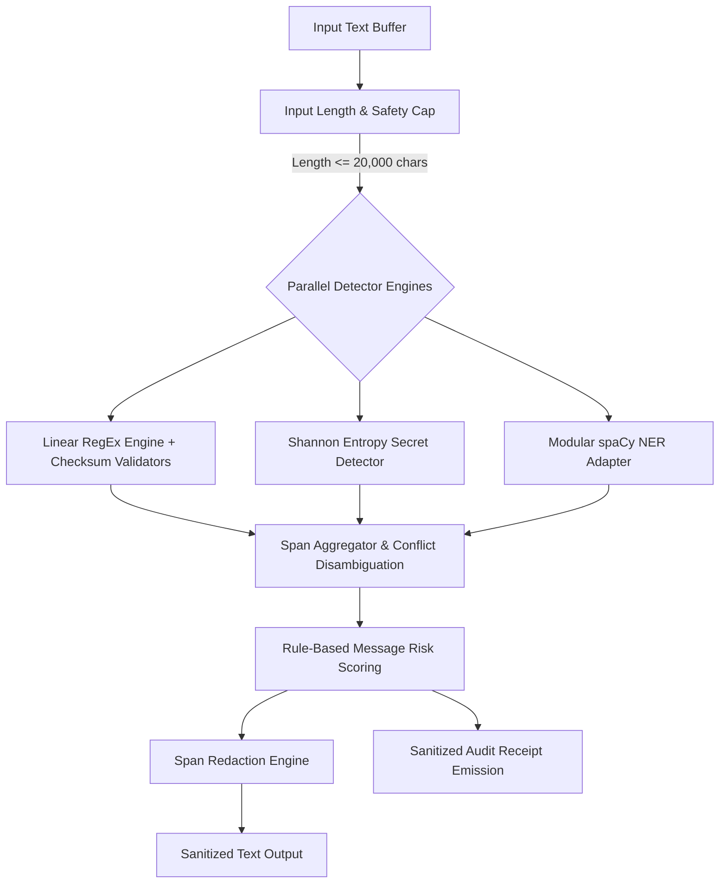

# 🛡️ LEAKGUARD — Security Intelligence Console

[](https://github.com/owner/AI-Data-Leak-Detection/actions/workflows/ci.yml)
[](https://www.python.org/downloads/)
[](docs/architecture.md)
[](LICENSE)
[](docs/privacy_and_threat_model.md)
[-success.svg)](docs/privacy_and_threat_model.md)

---

## 📌 Problem & Context

Accidental data leaks across developer communication channels, support tickets, staging configuration files, and AI prompt interfaces pose severe security and regulatory compliance risks. Unstructured text frequently exposes:
- **Cloud & Service Credentials:** AWS access keys (`AKIA...`), GitHub personal access tokens (`ghp_...`), private SSH/RSA keys, and database passwords.
- **Financial Identifiers:** Credit and debit card numbers, International Bank Account Numbers (IBAN).
- **Government & Citizen Identifiers:** Indian PAN Cards, Aadhaar numbers, Indian Voter IDs (EPIC).
- **Personally Identifiable Information (PII):** Email addresses, telephone numbers, and individual person names.

Legacy detection scripts often rely on naive keyword matching or uncalibrated statistical models that suffer from catastrophic false-positive rates (alerting on documentation domains like `user@example.com` or software versions like `v2.4.1`) or persist sensitive plaintext unencrypted to disk.

**LEAKGUARD** is a modernized, leak-safe Security Intelligence Console built to provide deterministic, explainable, and zero-retention detection and redaction.

---

## 🎯 Honest Scope & Non-Goals

### In Scope
- **Deterministic Entity Detection:** Linear-time regular expressions reinforced by mathematical checksum validators (Luhn Mod-10 for cards, Verhoeff for Aadhaar, ISO 7064 Mod-97-10 for IBAN, RFC documentation filters).
- **Shannon Entropy Secret Detection:** Token anchor parsing combined with Shannon entropy thresholds ($\ge 4.5$ bits/char) to isolate high-entropy passwords and API tokens.
- **Modular Statistical NLP:** Isolated `PERSON` entity extraction using spaCy's `en_core_web_sm` with clean offline fallback when models are not installed.
- **Policy-Aware Risk Triage:** Multi-factor scoring mapping messages into three explainable risk bands: `high_risk_exposure`, `possible_exposure`, and `no_exposure`.
- **Zero-Retention Interactive Console:** A local-first Streamlit web interface operating strictly in ephemeral memory with formula-safe CSV/JSON audit receipt exports.
- **Cryptographic Security Lab:** Educational demonstration of symmetric Authenticated Encryption with Associated Data (AEAD) via AES-256-GCM.

### Non-Goals
- **Endpoint Agent Daemon:** LEAKGUARD is an inspection and redaction engine for messages and documents; it is not an OS-level kernel file watcher or network packet sniffer.
- **Enterprise Key Management System (KMS):** The cryptographic lab demonstrates client-side AES-GCM mechanics with ephemeral keys; it does not replace hardware security modules (HSM) or cloud KMS services.
- **Irreversible De-Anonymization Defense:** Redaction replaces or masks identified tokens; it does not guarantee protection against stylometric authorship attribution or sophisticated differential privacy reconstruction.

---

## 🛡️ Shipped Features (Verified & Implemented)

1. **🔍 Live Scanner (`views/scanner.py`):**
   - Interactive analysis of text payloads (capped at 20,000 characters).
   - Side-by-side comparison of original text, highlighted entity spans, and safe masked values.
   - Dual-tier evidence rail detailing detector engine, verification algorithm, confidence, and severity.
   - Strict HTML entity escaping preventing Stored Cross-Site Scripting (XSS).
2. **🛡️ Redaction Studio (`views/redaction.py`):**
   - Three verified redaction modes: `placeholder` (`[REDACTED_CREDENTIAL]`), `mask` (`****************`), and `remove`.
   - Side-by-side visual diff and downloadable sanitized text files.
3. **📊 Executive Overview (`views/overview.py`):**
   - Visibly separated KPI cards comparing **Active Session Telemetry** with the **Held-Out Reference Corpus Benchmark** ($N=822$).
   - Altair comparative distributions for risk bands and detected entity classes with adjacent data tables.
   - Live detector registry health and a functional `Run Sample Scan` pipeline trigger.
4. **🚨 Incident Command Center (`views/incidents.py`):**
   - Searchable, sortable, paginated audit records derived from ephemeral session receipts.
   - Persistent filters in `st.session_state` (Severity, Risk Band, Search Query).
   - Toggle to inspect held-out benchmark reference incidents.
   - Sanitized CSV and JSON export guarded against spreadsheet formula injection (`=`, `+`, `-`, `@`).
5. **🧪 Model Laboratory (`views/model_lab.py`):**
   - Granular validation tables for character-offset entity detection and message-level risk classification.
   - Provenance ledger tracking Git commit, random seed 42, family group split method, and run date.
   - Interactive test set false-positive and false-negative inspection galleries.
   - Explicit **Classifier Gate Status: WITHHELD** card detailing the human challenge set requirement.
6. **📚 Methodology & System Health (`views/methodology.py`):**
   - 5-stage Mermaid pipeline architecture dataflow diagram.
   - Automated detector coverage matrix loaded from the active registry.
   - Dynamic dataset licenses and attribution read from `data/manifest.json`.
   - Platform runtime metadata and Python/package facts from `reports/run_metadata.json`.
7. **🔐 AES-GCM Security Lab (`labs/security_lab.py`):**
   - Ephemeral 256-bit symmetric encryption using `cryptography` AESGCM.
   - Unique 96-bit random nonces per encryption ($2^{96}$ collision space).
   - Authenticated Associated Data (AAD) support.
   - Active tamper simulation (bit-flipping) and wrong-key decryption failure demonstrations.

---

## 🏗️ Architecture Dataflow



---

## ⚙️ Quickstart & Local Setup

### Prerequisites
- Python `3.11` or `3.12`
- Git

### Installation Steps

```bash
# 1. Clone the repository
git clone https://github.com/owner/AI-Data-Leak-Detection.git
cd AI-Data-Leak-Detection

# 2. Create and activate a clean virtual environment
python -m venv .venv
# On Windows (PowerShell):
.venv\Scripts\Activate.ps1
# On Linux / macOS:
# source .venv/bin/activate

# 3. Install pinned developer dependencies and install package in editable mode
pip install -r .github/requirements-dev.txt
pip install -e .

# 4. Run the quality and security verification suite
ruff check .
ruff format --check .
pytest -q
pip-audit -r requirements.txt
```

---

## 🚀 Running the Console

Start the local-first Streamlit console:

```bash
streamlit run app.py --server.headless true --server.port 8501
```

Once running, navigate to `http://localhost:8501` in your browser.

---

## 📊 Dataset Generation & Evaluation Protocols

### 1. Synthetic Dataset Generation
LEAKGUARD includes a reproducible synthetic dataset generator utilizing 157 structured templates across 15 semantic families:

```bash
python -m leakguard.data.generate --count 4000 --seed 42 --out-dir data/processed
```

Dataset splits are strictly partitioned by `family_id` (60% Train, 20% Validation, 20% Test) to mathematically guarantee zero cross-split template leakage.

### 2. Standardized Evaluation Suite
Generate comprehensive evaluation benchmarks, bootstrap confidence intervals, and reference corpus receipts:

```bash
python -m leakguard.evaluation.report --out reports/
```

This generates:
- `reports/eval_latest.json`: Entity and message-level metrics, bootstrap CIs, and confusion matrices.
- `reports/reference_corpus.json`: Precomputed benchmark receipts for offline console exploration.
- `reports/run_metadata.json`: Platform, git commit, and package dependency provenance.

---

## 📈 Headline Evaluation Results & Classifier Gating

All figures below are copied verbatim from the reproducible evaluation artifact (`reports/eval_latest.json`):

### Held-Out Test Split Performance ($N=822$ messages, Seed 42, Group Split by Family)

| Evaluation Tier | Metric | Shipped Rule Baseline | 95% Bootstrap Confidence Interval |
| :--- | :--- | :--- | :--- |
| **Message-Level Risk Triage** | **Precision** | `1.0000` | `[1.0000, 1.0000]` |
| | **Recall** | `0.6483` | `[0.6139, 0.6811]` |
| | **F1 Score** | `0.7866` | `[0.7581, 0.8111]` ($B=1000$ resamples) |
| | **ROC-AUC** | `0.7975` | `[0.7711, 0.8213]` |
| **Entity-Level Detection** | **Exact Micro-F1** | `0.6698` | Exact character boundary matching |
| | **Relaxed Micro-F1**| `0.6698` | Relaxed span overlap matching |

### Classifier Gate Verdict: WITHHELD
- **Human Challenge Set Status:** `missing` ($N=0$).
- **Gating Rule:** To avoid releasing models that merely memorize synthetic template syntax, the trained Machine Learning classifier (Logistic Regression) is **strictly withheld** from production classification until an independent, human-authored challenge benchmark is evaluated.
- **Shipped Architecture:** The system operates strictly on the verified deterministic **Detector-Only v1** engine.

---

## 🖼️ Application Interface & Screenshots

All console views use safe synthetic demonstration text with zero live personal data.

To capture fresh screenshots locally:
1. Start the application: `streamlit run app.py --server.headless true --server.port 8501`
2. Open `http://localhost:8501` in your browser.
3. Save snapshots of each view into `assets/screenshots/`:
   - `01_live_scanner.png` (Live Scanner view)
   - `02_redaction_studio.png` (Redaction Studio with diff view)
   - `03_executive_overview.png` (Comparative KPI overview)
   - `04_incident_command_center.png` (Audit trail & timeline)
   - `05_model_laboratory.png` (Provenance ledger & evaluation metrics)
   - `06_methodology.png` (Architecture diagram & coverage matrix)
   - `07_security_lab.png` (AES-GCM encryption & tamper demo)

---

## 🔒 Privacy & Threat Model Summary

- **Local-First Processing:** Zero outbound network requests; no telemetry reporting.
- **Ephemeral Session Memory:** Scanned text is processed in volatile process RAM and discarded upon scan completion. Raw input text is never saved to disk or persistent session logs.
- **Formula Injection Mitigation:** Audit logs and CSV exports neutralize formula execution triggers (`=`, `+`, `-`, `@`, `\t`, `\r`, `\n`) by prepending a single quote (`'`).
- **XSS Immunity:** Annotated spans and user inputs are escaped via `html.escape()` prior to rendering.
- **ReDoS Resistance:** Linear-time regexes and a hard 20,000-character input cap prevent resource exhaustion attacks.

See [`docs/privacy_and_threat_model.md`](docs/privacy_and_threat_model.md) for the complete STRIDE threat analysis.

---

## ⚠️ Known Limitations

1. **Synthetic Template Bounds:** Metrics reflect synthetic templates; novel conversational evasions (e.g. spelling out card numbers in words) may evade detection.
2. **spaCy English Model Scope:** The `en_core_web_sm` model has lower recall on isolated mononyms or non-Latin transliterations.
3. **Shannon Entropy False Positives:** Harmless random hexadecimal strings (Git commit SHAs, UUIDs) may trigger high-entropy secret warnings.
4. **Input Size Ceiling:** Inputs exceeding 20,000 characters must be chunked externally.

See [`docs/limitations.md`](docs/limitations.md) for full disclosure of technical boundaries.

---

## 📚 Dataset Provenance, Attribution & Licences

The synthetic benchmark corpus is generated using synthetic templates and the Faker library:
- **Synthetic Templates:** Custom authored for LEAKGUARD (MIT License).
- **Faker Library:** Python `faker` library (MIT License).
- **Python Standard Library:** Python Software Foundation (PSF License).
- **Dataset Manifest:** Detailed record metadata and family splits documented in [`data/manifest.json`](data/manifest.json) and [`docs/data_card.md`](docs/data_card.md).

---

## 🚢 Deployment Roadmap

> [!NOTE]
> **Deployment Status:** **Not yet deployed** (Scheduled for Phase 10: Streamlit Community Cloud and Container Packaging).
> Currently runs locally via `streamlit run app.py`. See [`docs/deployment.md`](docs/deployment.md) for container specifications.

---

## 📄 License

This project is licensed under the **MIT License**. See the [LICENSE](LICENSE) file for complete details.
