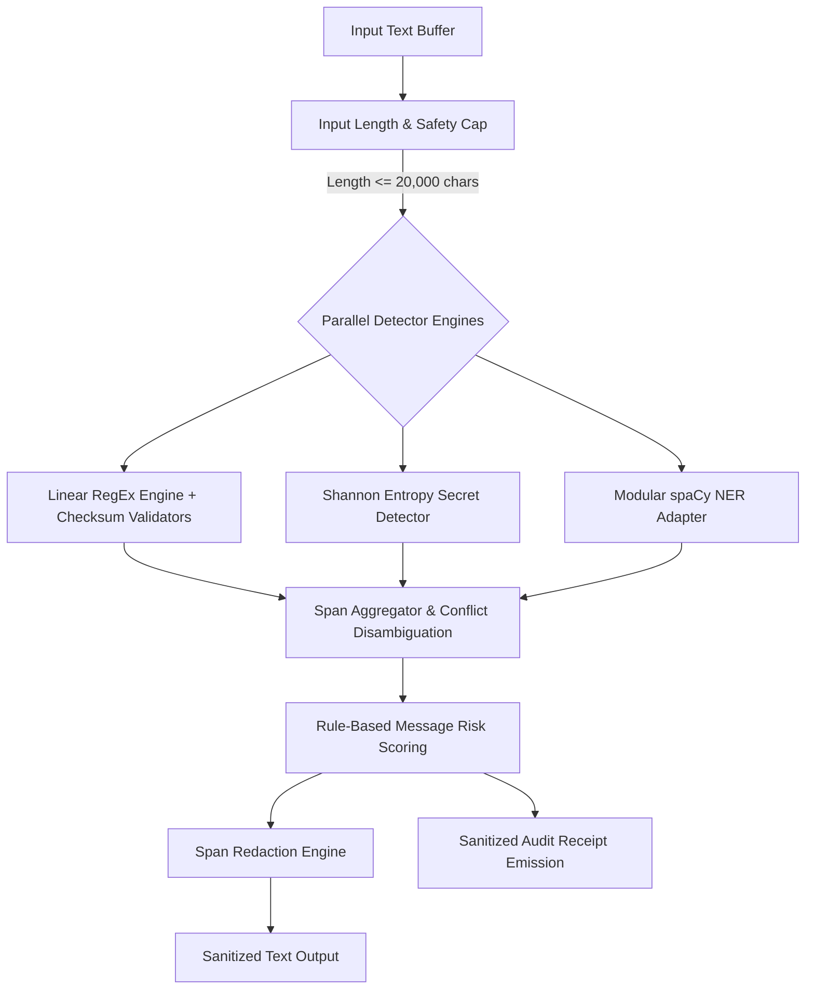

# LEAKGUARD — System Architecture & Technical Specifications

## 1. Architectural Overview

**LEAKGUARD** is a local-first Security Intelligence Console designed to detect, analyze, triage, and safely redact sensitive data exposures (personally identifiable information, technical credentials, financial identifiers, and authentication tokens) in unstructured text.

The system is architected around strict privacy-by-design invariants:
- **Zero Disk Persistence:** Raw input text is never written to disk, databases, temporary directories, or telemetry streams.
- **Detector-Only v1 Baseline:** Deterministic linear-time regular expressions, mathematical checksums, Shannon entropy estimators, and modular spaCy NER. Machine learning classification is withheld until an independent human challenge benchmark is evaluated.
- **Explainable Policy Scoring:** Risk levels (`no_exposure`, `possible_exposure`, `high_risk_exposure`) derive from explicit entity severities, category diversity, and presence of critical credentials.
- **Formula-Safe Auditing:** All emitted audit receipts and CSV exports neutralize spreadsheet formula injection characters (`=`, `+`, `-`, `@`, `\t`, `\r`, `\n`).

---

## 2. 5-Stage Dataflow Pipeline

### Stage 1: Input Cap & Guardrails
- Input length is validated against `LEAKGUARD_MAX_INPUT_LENGTH` (default: 20,000 Unicode characters).
- Over-limit inputs are rejected immediately with descriptive errors that never echo raw input text.
- ReDoS protection: all regular expressions execute in linear time without nested polynomial quantifiers.

### Stage 2: Parallel Detector Registry
1. **RegexDetector (`RegexDetector`):**
   - Matches structured entities (Emails, Indian & International Phone Numbers, PAN Cards, Aadhaar Numbers, Indian Voter IDs, Credit/Debit Cards, IBANs, IP Addresses).
   - Enforces algorithmic validation:
     - Luhn Algorithm (Mod-10) for credit/debit card checksums.
     - Verhoeff Algorithm for 12-digit Indian Aadhaar identification numbers.
     - ISO 7064 Mod-97-10 for International Bank Account Numbers (IBAN).
     - Linear RFC domain filters blocking documentation domains (`example.com`, `invalid`, `localhost`).
2. **SecretDetector (`SecretDetector`):**
   - Combines structural token anchors (e.g. AWS access keys `AKIA...`, GitHub tokens `ghp_...`, Slack tokens `xoxb-...`) with Shannon entropy bounds.
   - Evaluates Shannon entropy $\ge 4.5$ bits/char for high-entropy assignment strings (`api_key = ...`, `password = ...`).
3. **NERAdapter (`SpacyNERAdapter`):**
   - Isolates statistical NLP execution using spaCy's `en_core_web_sm` model.
   - Handles `PERSON` entity detection.
   - Graceful offline fallback: if spaCy or its language model is unavailable, the pipeline operates without failure, surfacing a clear status notification in the runtime telemetry rail.

### Stage 3: Span Aggregator & Disambiguation
- Merges overlapping or adjacent candidate spans from multiple detectors.
- Disambiguation rules:
  1. Priority given to checksum-validated detectors over statistical NER.
  2. For identical intervals with conflicting labels, highest severity rank wins (`CRITICAL > HIGH > MEDIUM > LOW`).
  3. Strict 0-indexed Unicode character offsets `[start, end)` into the unnormalized input string are preserved.

### Stage 4: Policy Risk Scoring
- Evaluates total findings, category diversity, and maximum entity severity.
- Risk Bands:
  - `high_risk_exposure`: Any `CRITICAL` finding (passwords, private keys, API secrets) or $\ge 2$ distinct `HIGH` categories.
  - `possible_exposure`: At least one `HIGH` or `MEDIUM` finding (email, phone, voter ID, person name).
  - `no_exposure`: Zero findings, or solely benign documentation samples.

### Stage 5: Redaction & Receipt Emission
- **Redaction Modes:**
  - `placeholder`: `[REDACTED_CREDENTIAL]`, `[REDACTED_EMAIL]`
  - `mask`: `****************`
  - `remove`: Deleted entirely with normalized spacing.
- **Audit Receipt (`ScanReceipt`):**
  - Sanitized audit log containing execution timestamp, duration in ms, character length, detectors run, and finding counts by type/severity.
  - Strictly contains **zero raw input text** and **no reversible hashes of secret values**.

---

## 3. Ephemeral Cryptographic Lab Architecture

The **Security Lab** (`labs/security_lab.py`) provides an isolated cryptographic sandbox implementing NIST SP 800-38D AES-256-GCM:
- **Key Generation:** 256-bit cryptographically secure keys generated in memory via `os.urandom`.
- **Nonce Invariant:** Unique 96-bit (12-byte) random nonce per encryption ($2^{96}$ collision space).
- **Authenticated Associated Data (AAD):** Contextual metadata authenticated into the 128-bit tag without plaintext encryption.
- **Tamper Evident:** Bit-flipping in ciphertext or tampering with AAD triggers immediate `InvalidTag` / `AuthenticationFailedError`.
- **Legacy Deprecation:** Intentionally dropped unauthenticated, disk-based RSA-2048/EAX schemes from legacy exploration.

---

## 4. Technology Stack & Runtime Dependencies

| Component | Technology | Version | Purpose |
| :--- | :--- | :--- | :--- |
| **Language Runtime** | Python | `3.11.9+` | Modern type hints, `StrEnum`, strict performance |
| **UI Framework** | Streamlit | `1.66.0` | Local web application shell via `st.navigation` |
| **Data Processing** | pandas | `3.0.6` | Tabular analytics and audit data representation |
| **Machine Learning** | scikit-learn | `1.9.1` | Evaluation metrics, baseline algorithms, vectorizers |
| **NLP Engine** | spaCy | `3.8.16` | Statistical Named Entity Recognition (`PERSON`) |
| **Cryptography** | cryptography | `50.0.2` | NIST SP 800-38D AES-256-GCM AEAD primitive |
| **Linter / Formatter**| Ruff | `0.17.1` | High-speed static analysis and style enforcement |
| **Test Framework** | pytest | `9.1.1` | Comprehensive unit, property, and AppTest suite |
| **Vulnerability Audit**| pip-audit | `2.10.1` | Automated PyPI advisory database verification |
